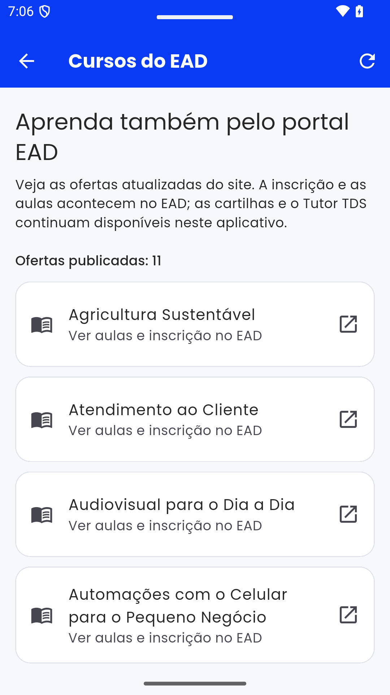
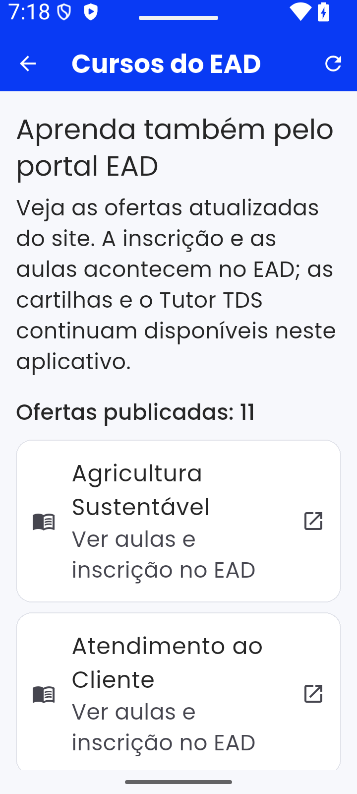

# Convergência pedagógica EAD → Tutor TDS: matriz real, 17/10/2026

Esta é uma auditoria reprodutível e **somente leitura**. Os números não constituem autorização para substituir notas, matrículas, direitos, certificados ou publicar novas versões das cartilhas.

## A lógica do produto que deve ser preservada

O WordPress/LearnPress é a referência editorial das ofertas e da ordem de consumo. O aplicativo Flutter deve compartilhar essa jornada de aula e vídeo, mantendo como diferenciais seu Tutor IA contextualizado, cartilhas acessíveis/offline quando autorizadas, atividades formativas, tentativas com reconciliação, gestão da equipe e suporte. A FastAPI/PostgreSQL continua responsável pelos processos transacionais, vínculos/escopos e versionamento acadêmico. A saída correta não é criar outra API do zero nem transferir decisão acadêmica para um Worker/Lambda.

## Provas desta rodada

- `GET /wp-json/wp/v2/lp_course` confirmou **11 cursos publicados**; os nove originais são os analisados aqui.
- `GET /wp-json/learnpress/v1/courses/{id}` para os nove originais: **95 lições**, 48 itens localizados nas seções de videoaula verificadas. `video_candidate=true` significa associação editorial pela seção, não validação de cada MP4/YouTube/legenda.
- `GET /wp-json/wp/v2/lp_quiz` confirmou **29 quizzes publicados**.
- `SELECT` somente leitura em `wp_learnpress_sections` + `wp_learnpress_section_items` confirmou **zero quizzes nas seções dos 11 cursos publicados**. O banco também contém 282 registros `lp_question`; 25 quizzes têm questões vinculadas na tabela `wp_learnpress_quiz_questions`; quatro não apresentam questões nessa relação.
- Nove cartilhas locais no checkout `staging@b0c39b2` do Flutter: **38 blocos `question`**, zero `quiz`, e nenhum marcador `isCorrect:true` nos assets auditados. Os gabaritos e as tentativas oficiais não foram exportados.
- Uma auditoria `audit.py` validou 9/9 cursos, sequência, IDs de seção, 48 candidatos de vídeo, 38 questões formativas e status das 29 provas **sem inferir associação**. 9 testes sintéticos PASS.
- Snapshot auditado: `docs/qa/ead-convergence-20261017/curriculum-snapshot.json`, SHA-256 `0CDB7BFB9F59A9B16129EB62A4EC6EDE637DC27739478EE5BDB47913F49402BF`.

### Comparativo por curso

| Curso (ID Flutter) | ID LearnPress | Lições EAD | Vídeos | Blocos formativos no app | Quizzes vinculados à seção |
|---|---:|---:|---:|---:|---:|
| IA e inclusão digital (`ia-cartilha`) | 614 | 17 | 12 | 4 | 0 |
| Agricultura sustentável | 1298 | 13 | 6 | 6 | 0 |
| Atendimento ao cliente | 1307 | 9 | 4 | 4 | 0 |
| Audiovisual | 1314 | 9 | 4 | 4 | 0 |
| Cooperativismo | 1321 | 10 | 5 | 4 | 0 |
| Economia do lar | 1328 | 9 | 4 | 4 | 0 |
| Educação financeira | 1335 | 11 | 5 | 5 | 0 |
| SIM/SIMA | 1343 | 9 | 4 | 4 | 0 |
| SAF | 1356 | 8 | 4 | 3 | 0 |
| **Total** | | **95** | **48** | **38** | **0** |

Os cursos extras `automacoes-celular` (1474) e `ia-processos-internos` (1709) aparecem no catálogo público, mas não existem como cursos equivalentes na API/app original. Evitar prometer Tutor RAG específico ou divulgar formação interna em campanhas sem classificação editorial.

## Por que não importar automaticamente os quizzes

Vincular quiz por título, ordem ou semelhança de texto seria uma hipótese, não prova. O próprio LearnPress não os relaciona hoje ao currículo publicado. As configurações de retentativa/nota e os itens de gabarito são independentes. Para cada avaliação será exigido: instrutor responsável, IDs de curso/seção/aula/quiz, condição de acesso, questões aprovadas, regras de nota e retentativa, diferença entre experiência formativa e prova, e resultado esperado no Tutor TDS. Isso evita alunos serem reprovados ou certificados a partir de uma associação inventada.

## Experimento de convergência proposto

1. **Leitor de trilha por curso:** o app consome um snapshot somente leitura da ordem LearnPress, mostra título da aula, indicação visual de vídeo, cartilha e questões formativas do app. Não reescreve `CourseVersion` por GET. Quando offline, cartilhas locais e tentativas permanecem protegidas.
2. **Mídias:** importar URL/ID do YouTube validado pelo manifesto #217, na posição correta da aula, com legenda livre de sobreposição, direitos e status editorial. Não misturar upload YouTube com `visibility=unlisted` da API, que é excluída do catálogo.
3. **Tutor contextual:** manter `course_version_id` e `module_id` existentes como fronteira de grounding; somente mapear `wp_lesson_id` para contexto quando uma fonte concreta de cartilha estiver revisada. Se não houver contexto, Tutor declara essa limitação em vez de inventar explicação.
4. **Avaliações:** preservar `PublishedAssessmentController`, `AssessmentSyncCoordinator`, outbox durável e autorizações da FastAPI; converter questões/provas somente após mapeamento humano e publicação de nova versão imutável. Não inferir aprovação por clique no vídeo.
5. **Fluxo de entrada:** manter descoberta EAD sem CPF na tela de boas-vindas, usando navegador externo para matrícula LearnPress; SSO futuro só após testes de identidade. Novos cursos entram em campanhas apenas após público-alvo e conteúdo definidos.

## Arquiteturas competindo em QA

| Opção | Vantagem | Risco | Hipótese de aceitação |
|---|---|---|---|
| A: app espelha sequência com mídia embutida + Tutor; backend guarda versão e tentativas | Experiência integrada, evita duplicar LMS | Mapeamento inicial por instrutor | Preferida para os nove cursos após piloto SAF |
| B: WebView LearnPress + Tutor em área separada | Copia o LMS sem migrar avaliações | Login/cookies, usabilidade e autorização separada | Plano de contingência até mapeamento aprovado |
| C: replicar todo o LMS/provas na API | UX nativa completa | Manutenção duplicada, risco de divergência e notas | Não selecionar sem prova de menor custo e precisão |

## Testes e revisões periódicas

Execução sintética 9/9 PASS para parser/contrato; auditoria real GET PASS para contagens. Evidências visuais reais do catálogo EAD-first: imagens abaixo, extraídas do Android 35 no DESKTOP-8T5DRBS, **não** mostram avaliação ou Tutor em contexto. Todos os novos materiais devem seguir esse padrão: SHA Git, tipo de dispositivo, navegação real, screenshot, vídeo e situação `PASS/BLOCKED`.

**Limites:** no Android 36.1 do desktop houve `System UI isn't responding` sob baixa RAM, ainda sem evidência de defeito Flutter. Vídeos de QA capturados sem áudio do sistema. A publicação de material promocional depende de revisão institucional de direitos/privacidade.

## Próxima decisão humana prioritária

Selecionar com o primeiro instrutor o piloto SAF (1356): confirmar sequência de quatro aulas textuais + quatro vídeos, escolher quais experiências formativas das três do app acompanham cada passo, e indicar qual prova (se houver) deverá ser vinculada. Repetir piloto em outro curso antes de realizar importação dos nove. Registrar aprovação editorial e nova `CourseVersion`, sem mutação silenciosa do progresso anterior.

**Agente e IA:** Nemotron Nano 9B Q4 já está servido localmente na VM L4, mas a chamada para crítica técnica excedeu timeout em 17/10. Não houve parecer. Ele pode sugerir mapeamentos ou testes sintéticos em lote quando a GPU estiver livre, mas nenhum modelo substitui as fontes EAD, validação do instrutor ou testes Flutter/pytest. Atualizações de QA programadas diariamente, com links reais quando disponíveis.

## Reexecutar auditoria

Do checkout da branch candidata: `python tooling/qa/ead_curriculum/audit.py --output /caminho/novo/snapshot.json`; o script não sobrescreve snapshots existentes. Testes: `python -m unittest discover -s tooling/qa/ead_curriculum -p test_audit.py -v`. Nunca executar com credenciais WordPress ou exportar tentativas dos alunos.
