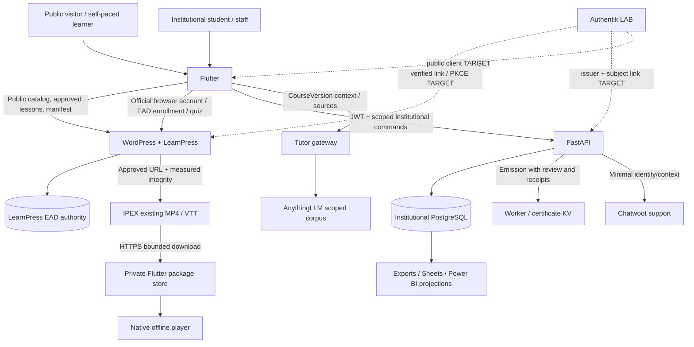

# Authorities and dependency/impact map

Later EAD decision #249 and `docs/DOMAIN_CONTRACT.md` take precedence over older
program documents. Existing draft #250 already reconciles these documents;
**REUSE/INTEGRATE that proposal**, do not create competing authority definitions.

| Boundary | Canonical owner and contract | Failure consequence / required control |
|---|---|---|
| WP account ↔ institutional account | Separate today; OIDC target `(issuer,sub)` with explicit consent | No silent duplication or linking by email/CPF; logout of one does not prove the other ended |
| LP course/lesson ↔ TDS CourseVersion | Reviewed ID/revision crosswalk, not title matching | 11 EAD offers vs 9 TDS courses; two extras remain unmapped |
| LP lesson/quiz completion | LearnPress | Never becomes attendance, institutional grade or official certificate implicitly |
| Cohort lifecycle | FastAPI, scoped program role + command receipt | Activation must update teacher/monitor/student projections; retry cannot duplicate class or enrollment |
| Institutional progress | Enrollment+fixed CourseVersion projection | Reading position and page time are separate; edition updates cannot reset old cohort progress |
| Attendance | FastAPI presence policy and review | Expired numeric code is not necessarily an expired login; check #159 against exact candidate |
| Certification | FastAPI policy/review + authenticated Worker/KV | Generation, eligibility, instructor validation, coordinator signature and validity stay distinct |
| Offline media | WP editorial opt-in/source fingerprint + byte manifest; local integrity | A URL/ETag alone is insufficient; manifest revocation must precede conditional 304; client verifies bytes |
| Offline institutional commands | Owner/API/context outbox + server idempotency | No cross-user replay; offline snapshot grants no new rights; no invented LMS write queue |
| AI | Authorized context + versioned corpus, advisory only | No sources/unmapped scope -> explicit unavailable; successful model response proves no pedagogical correctness |
| Support / analytics | Conversation / projection only | No authorization from tickets, labels, BI rows or AI; minimize PII, consent before analytics |

## Exact draft dependencies recovered

`#316 817432bc → #317 0cda0173 → #319 → #321 → #323 → #324 5c2e41c8`
(the intermediate chain is recorded in #324's body; only selected heads were
individually fetched). #324 branches into #326 Android registration QA,
#331 storage and #332 identity lab. #334 `a0db1025` builds on #331 `1c23630e`.
This manifest increment builds on #334; #335 fixes that same base in a separate
writer. #328 analytics is another sibling and is not automatically included.

`#250` authority reconciliation and `#260 → #263 → #266` detached Minha Área
are separate drafts, not present merely because #334 exists. #175 module RAG
scope remains an open proposal with local evidence; CourseVersion sentinel
proof belongs to the earlier #136. Exact selected base/head pairs and CI run IDs
are in `state-recovery.json`. A green sibling is not a green combined candidate.

## Shared roots and minimal consolidation

1. **Evidence without a common source:** tests/physical captures belong to
   different SHAs. Reuse immutable artifacts only when provenance matches; run
   only affected regression until the final release gate.
2. **Authority documentation drift:** reuse #250; keep EAD and institutional
   completion distinct in UI/repositories/export. No new academic service.
3. **Interfaces without authoritative adapters:** Minha Área has tested UI and
   controller, but no verified reader. Authentik discovery is not that reader.
   Wire existing components after account proof; do not add a third account DB.
4. **Media metadata without verified bytes:** this #336 slice bridges the
   existing producer/consumer schema; native player QA remains #335/#333.
5. **New paths outside shared regression:** registration changes session/support/
   privacy attribution; player changes lifecycle/captions/offline; enrollment
   changes attendance/completion/reporting. Acceptance follows downstream roles,
   not PR labels.

Drupal is a historical alternative superseded by the later WordPress direction
(Issue #213). **REMOVE** only after a dependency/config inventory proves it is
unused; no deployment, directory or service is deleted in this increment.
