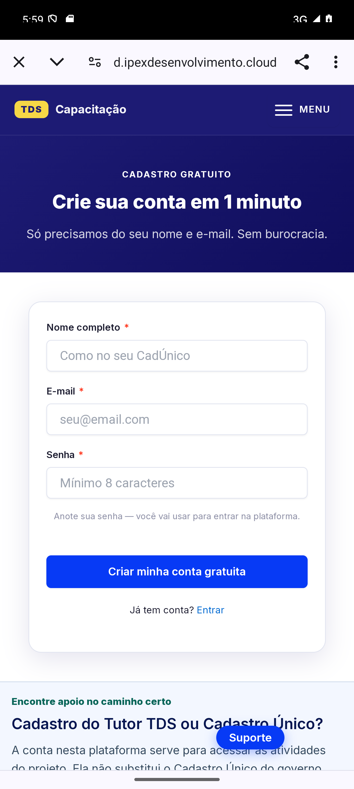

# PR #324: homologação Android reproduzível do cadastro

Issue #325. Base do app/APK: `5c2e41c87a7af145442d6e7b12fb205c1a081628`.
Somente runner, testes e evidências. Flutter, WordPress, configurações de release e privacidade inalterados.

## Resultado observado em 22/10/2026

**PASS para navegação da tela inicial já aberta até o formulário real WordPress, sem submissão.** O run `run-07-form-navigation` ocorreu às **14h59min17s–14h59min50s de Brasília** (17:59 UTC), terminou com exit 0 e 10/10 verificações PASS. Não é aceite de cold start, cadastro concluído, matrícula ou release.

- LARGeo; Pixel_8_Pro Android 15/API35; `emulator-5554`; ADB 5037.
- APK existente, 104.632.454 bytes, SHA-256 `35eead93c801835eb1973ee7b560c5e2428caba43eb6e7adb9ce7c26c4604424`, **sem reconstrução**.
- Pacote exato `com.tutortds_cartilhas.dev.dynamicqa.r5c2e41c87a7af145442d6e7b12fb205c`, launcher `com.tutortds_cartilhas.MainActivity`.
- Hash do APK instalado conferido pelo Android; `primaryCpuAbi=arm64-v8a` depois da reinstalação isolada com `--abi arm64-v8a`.
- CTA selecionado pela árvore atual do pacote correto, em `(672,1675)`. Nenhum lançamento direto da URL foi usado para substituir o clique.
- Custom Tab abriu a URL HTTPS `/cadastro/` com `utm_source=tutor_tds_app`, `utm_medium=app`, `utm_campaign=ead_signup`, `utm_content=welcome_signup`.
- DOM da página **ativa, visível, focada e complete** confirmou o formulário institucional `POST /wp-admin/admin-post.php`, discriminador `tds_cadastro`, campos nome/e-mail/senha e submit visíveis/habilitados. Foram lidos nomes/tipos/visibilidade, **não valores de senha, e-mail, nonce ou cookies**.
- Captura Android original `run-07-form-navigation/02-form.png` foi inspecionada visualmente e mostra o formulário correto. Fechar a Custom Tab retornou ao pacote exato; nenhuma conta ou matrícula criada.
- A árvore nativa do Chrome expôs apenas toolbar, apesar do formulário renderizado. `uiautomator_exposes_web_form=false` é preservado: esta prova não homologa acessibilidade web/TalkBack.
- Pacote Play ausente no AVD antes/depois (`play_before=[]`, `play_after=[]`); o teste não instalou, limpou, removeu ou abriu `com.tutortds_cartilhas`. Nenhuma ação de escrita em aparelhos físicos. A versão física publicada não foi revalidada nesta tarefa.



O [recibo](run-07-form-navigation/receipt.json) contém resultados individuais, horários, URL e hashes dos 15 arquivos de evidência. Os PNGs são capturas separadas; não se alega vídeo contínuo.

## Causas e correções

| Evidência OBSERVED | Correção implementada | Limite |
|---|---|---|
| Crash de #324: `libflutter.so is for EM_AARCH64 (183) instead of EM_X86_64 (62)`; pacote instalado como x86_64 | Inspecionar as ABIs de **libflutter.so** no ZIP e comparar com `primaryCpuAbi`; reinstalar o mesmo APK com ABI arm64 explicitamente suportada | `aapt native-code` inclui ABIs de plugins e não prova compatibilidade do motor Flutter; tradução não é presumida |
| Nove variantes QA; `am start Status: ok` enquanto activity retomada era r5e5045...; ANR desse pacote antigo | Manifesto/hash/pacote/SHA exatos, resolução do launcher e verificação foreground antes e depois de capturar e antes de tocar | Inferência: crash/falha de transição deixa tarefa anterior visível; não há prova de defeito da navegação Dart |
| `am start -W` retorna timeout antes de o app posteriormente renderizar | Registrar o timeout; espera limitada por activity/PID e janela desenhada; comprovação separada do CTA | Cold start completo ainda não foi aceito; PASS final é `--resume` |
| UIAutomator pode retornar erro em stderr com exit 0 e não gerar XML | Capturar stderr, exigir mensagem de dump e XML único por execução/etapa, validar pacote; nunca consumir XML anterior | Null root/idle continuam falhas explícitas, sem toque por coordenada de screenshot |
| Chrome mostra formulário no PNG, mas árvore nativa contém só toolbar | Combinar UI nativa para controles com DOM CDP **somente leitura** da página existente, focada, URL exata e formulário específico | Não prova TalkBack, POST de cadastro ou conversão analytics |
| Activity retomada pode faltar durante transição; Back pode apenas fechar dica do Chrome | Espera limitada pela activity; retorno pelo controle Close tab selecionado na árvore | Não alterar proteções, flags do Chrome ou contas |

Fonte do erro ABI: [observed-abi-crash.txt](observed-abi-crash.txt), buffer do Android, timestamp 22/10 01:11:42; diagnóstico coletado nesta tarefa. Arquivo registra somente linhas pertinentes. AOSP [DumpCommand](https://android.googlesource.com/platform/frameworks/testing/+/refs/heads/main/uiautomator/cmds/uiautomator/src/com/android/commands/uiautomator/DumpCommand.java) confirma as saídas de erro/ausência de XML. [Android tasks/back stack](https://developer.android.com/guide/components/activities/tasks-and-back-stack) documenta a separação entre tasks e atividades.

## Histórico honesto das tentativas

| Execução | Resultado | E2E |
|---|---|---|
| run-01 | FAIL preflight: boot ainda incompleto | NOT_RUN |
| run-02-abi-negative | FAIL: timeout lendo hash instalado; não chegou ao teste ABI | NOT_RUN |
| run-03-arm64 | Instalação, hash e ABI PASS; FAIL do critério antigo baseado exclusivamente no timeout de am start | NOT_RUN |
| run-04-navigation | Pacote/ABI/launch PASS; FAIL UI imediata sem hierarquia, antes da correção de espera/diagnóstico | NOT_RUN |
| run-05-resume | UI e clique executados; FAIL do runner por activity transitória ausente; formulário observado em inspeção separada | FAIL no runner |
| run-06-dom-oracle | FAIL fechado: Chrome ainda em primeiro plano após Back, recusou confundir com app | NOT_RUN |
| run-07-form-navigation | 10/10 PASS, incluindo DOM e PNG do formulário e retorno | PASS, navegação sem submissão, app já aberto |

AVD legado tinha ANRs e histórico de crashes sistêmicos. Reinício normal ficou offline; reinício sem snapshot, headless, sem áudio e com SwiftShader, 3 GiB/2 cores, seguido de reconexão ADB recuperou boot/UI. Nenhum wipe, remoção de pacote ou nova imagem. Causa exclusiva da instabilidade do AVD não foi determinada. Logs brutos/intermediários permanecem fora do commit; seus resultados não são promovidos a aprovação funcional.

## Reprodução

Pré-requisitos: Python >=3.11, Android platform-tools/aapt, emulador API35 com ABI compatível, Chrome e módulo Python `websocket-client` (já disponível no ambiente validado). APK e hash acima. Nenhuma conta real. Fechar previamente a Custom Tab de cadastro: o runner rejeita alvo idêntico já existente para não aceitar página antiga como novo handoff. Não executar dois operadores simultaneamente no mesmo emulador.

Na raiz do repositório, PowerShell (ajuste somente caminhos/serial/porta ao ambiente):

```powershell
python tooling/mobile_qa/emulator/registration_apk_qa.py `
  --adb D:/DevTools/AndroidSDK/platform-tools/adb.exe `
  --aapt D:/DevTools/AndroidSDK/build-tools/36.0.0/aapt.exe `
  --adb-port 5037 --serial emulator-5554 `
  --apk D:/AI-Shared/builds/tutor-tds/ead-signup-analytics-20261021/tutor-tds-qa-5c2e41c-arm64-debug.apk `
  --sha256 35eead93c801835eb1973ee7b560c5e2428caba43eb6e7adb9ce7c26c4604424 `
  --source-commit 5c2e41c87a7af145442d6e7b12fb205c1a081628 `
  --package com.tutortds_cartilhas.dev.dynamicqa.r5c2e41c87a7af145442d6e7b12fb205c `
  --resume --output D:/AI-Shared/test-results/tutor-tds/pr324-new-run
```

`--resume` exige o app exato já aberto e registra que não houve cold start. Sem essa opção, faz launch explícito/frio com espera limitada; esse modo ainda exige aceite próprio neste ambiente. Se a ABI instalada estiver errada/ausente, acrescentar **uma vez** `--install-abi arm64-v8a` em emulador que suporte essa ABI. O runner valida manifesto, digest e pacote isolado antes de instalar. Não use isso para contornar HyperOS: aparelhos físicos são recusados.

Cada saída deve ser diretório novo. Exit 0 só com todas as etapas PASS; falha de pré-requisito deixa dependentes NOT_RUN. Não reaproveitar recibo de outra fonte. Verificar hashes:

```python
import hashlib, json
from pathlib import Path
p = Path('docs/qa/pr324-android-registration-20261022/run-07-form-navigation')
r = json.loads((p/'receipt.json').read_text(encoding='utf-8'))
assert all(hashlib.sha256((p/n).read_bytes()).hexdigest() == h for n,h in r['evidence_sha256'].items())
```

## Testes e gates

`python -m unittest discover -s tooling/mobile_qa/emulator -p 'test_*.py' -v`: **29/29 PASS** (11 existentes e18 novos), log `runner-tests.txt`. Cobrem ABI mista, pacote incorreto, XML residual/nulo, erro stderr com exit0, URL indevida/PII extra, formulário oculto/desabilitado/em outra página e estados FAIL/NOT_RUN. Testes Flutter18/18 e CI3/3 do PR324 são históricos do SHA base; não foram reexecutados nem substituem o ensaio Android. CI da nova branch deve ser verificado separadamente.

**NOT_RUN nesta tarefa:** Xiaomi/HyperOS, Samsung E2E (rede continuava ausente em leitura), cadastro POST, login, cadastro por curso, matrícula, analytics de conversão, áudio/TalkBack, cold start completo, assinatura/AAB/Play. Nenhum gate institucional GA4/consentimento foi fechado. `MERGE_ALLOWED=NO`, `release_build_allowed=false`; sem merge/publicação/configuração produtiva.

Rollback do código: reverter somente este commit de runner/docs. O APK original permanece byte a byte idêntico. Recuperação do AVD não apagou dados; flags headless/software/sem áudio são argumentos dessa execução, não alterações no config.ini. Não confundir preservação do APK com liberação de assinatura/publicação.

## Empacotamento das evidências

Textos foram normalizados somente de CRLF/CRCRLF para LF para portabilidade; resultados, horários e PNGs não foram alterados. `original-run-bytes.zip` preserva todos os bytes e recibos originais das sete execuções. `text-packaging.json` registra os hashes anteriores e normalizados, mais o hash do ZIP. Os recibos de consulta apontam para os hashes dos textos normalizados. `.gitattributes` preserva bytes ao clonar. O runner passa a gravar texto UTF-8/LF diretamente, com teste de regressão. AVD encerrado após a coleta; nenhum processo de QA deixado rodando.
